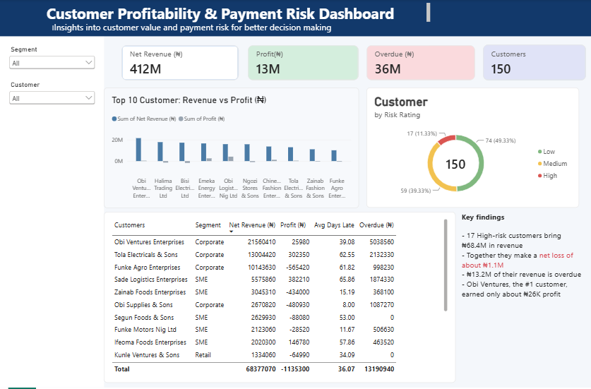

# Customer Profitability & Payment Risk Analysis

An end-to-end analysis of which customers actually make a company money, and which ones tie up its cash. Built with **SQL Server, Excel and Power BI**.

> **Data note:** all data is **simulated** (amounts in naira) and was created for practice. It does not belong to any real company.

## Business questions
1. Which customers are truly profitable after discounts, returns and costs?
2. Which customers pay late, and how much cash is overdue?
3. Which high-revenue customers cost the company money?
4. How much revenue sits with high-risk customers?

## Data
| Table | Rows | Contents |
|---|---|---|
| customers | 150 | segment, city, credit terms |
| invoices | 1,514 | amounts, discounts, cost of goods, delivery cost |
| payments | 1,488 | payment dates and amounts |
| returns | 158 | returned amounts per invoice |

Reporting date used for overdue amounts: **30 Sep 2026**.

## Process
1. **Clean (SQL Server):** removed 14 duplicate invoices, standardised segment spelling, and replaced 9 blank cities with "Unknown". Original tables were kept and cleaned copies were created.
2. **Analyse (SQL):** built one row per invoice, then one row per customer, calculating profit, discounts, returns, amount outstanding, overdue amount and average days paid after the due date.
3. **Score (Excel):** rated each customer High, Medium or Low risk using points for a thin or negative profit margin, late payment and a large overdue share of revenue. The thresholds sit in an Assumptions sheet and can be changed.
4. **Visualise (Power BI):** built a dashboard with key figures, a top-10 revenue vs profit chart, a risk-rating donut, segment and customer filters, and a table of high-risk customers.

**Profit** = gross amount - discount - returns - cost of goods - delivery cost

## Key findings
- Net revenue is **₦412.1M**, but profit is only **₦13.4M** (about 3.2% margin).
- **42 of 150 customers** are unprofitable.
- **17 customers** are rated High risk. They bring **₦68.4M** in revenue, make a **net loss of about ₦1.1M**, and have **₦13.2M** of overdue invoices.
- The **top 20% of customers** bring **64.5% of revenue** but only **44.1% of profit**.
- The #1 customer by revenue, **Obi Ventures Enterprises** (₦21.6M), earned only about **₦26K profit**, pays about 39 days late on average, and has about ₦5.0M overdue.
- Some large customers, such as Halima Trading and Bisi Electricals, pay on time but still lose money, so late payment is not the only risk.

## Recommendations
- Review discounts for high-revenue, low-margin customers before renewing terms.
- Tighten credit terms or follow up earlier on customers who pay more than 30 days late.
- Track profit per customer, not just revenue, when judging account value.

## Files
- `analysis.sql` - all cleaning and analysis queries in one ordered file
- `sql_drafts/` - the same queries as separate numbered files (find duplicates, clean invoices, clean customers, invoice summary, customer summary, top customers, receivables aging)
- `Customer_Risk_Scorecard.xlsx` - customer scorecard with risk ratings
- `Dashboard.png` - dashboard screenshot
- `customers.csv`, `invoices.csv`, `payments.csv`, `returns.csv` - the four simulated source tables
- `customer_summary.csv` - customer-level output from SQL, used for the scorecard and dashboard

## Tools
SQL Server (SSMS), Microsoft Excel, Power BI
